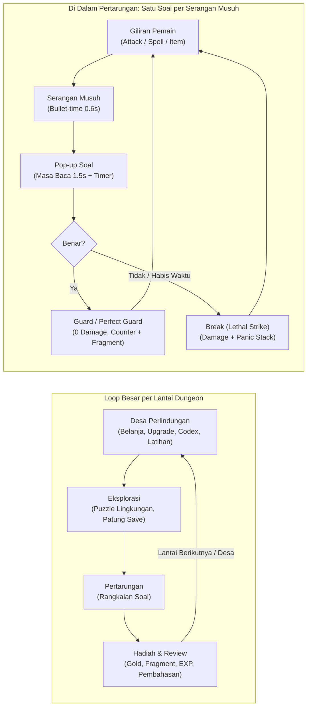

# Game Design Document — Grimoire's Aegis: The Scholar Knight

**Kelompok 3**
- **Ariel Hidayatul Faqih** — `2401265`
- **Muhammad Akbar Imron** — `2400000`
- **Muhammad Raditya Santosa** — `2409461`
- **Khairatul Husna Tartila** — `2400494`
- **Septin Sehawati** — `2400923`

---

## 1. Identitas Inti Game

*Grimoire's Aegis* adalah RPG turn-based dark fantasy di mana setiap serangan musuh hanya bisa ditangkis dengan menjawab soal *searching* atau *sorting* di bawah tekanan waktu.

| Atribut | Detail |
| :--- | :--- |
| **Judul** | *Grimoire's Aegis: The Scholar Knight* |
| **Subjudul (opsional)** | *The Order of Lost Indexes* |
| **Tagline** | *"Di dunia yang diacak kekacauan, hanya logika yang bisa menemukan jalan pulang."* |
| **Genre** | 2D Dark Fantasy RPG, Turn-Based Combat, Edutainment |
| **Platform** | PC (Windows) sebagai target utama; Android sebagai target kedua (lab sekolah & HP siswa) |
| **Engine (rekomendasi)** | Godot 4 (ringan, gratis, ekspor PC + Android) atau Unity 2D |
| **Kontrol** | Keyboard, gamepad (D-Pad), dan layar sentuh |
| **Target pemain** | Siswa SMK RPL / TKJ / PPLG (15–18 tahun) dan mahasiswa IT pemula |
| **Prasyarat pemain** | Paham variabel, array/list, perulangan, dan percabangan dasar |
| **Durasi sesi** | 15–25 menit per lantai dungeon, agar muat dalam satu jam pelajaran bersama pembukaan dan refleksi |
| **Total konten** | $\pm$ 6–8 jam (Prolog + 3 Act + Final) |
| **Rating konten** | Kekerasan fantasi ringan tanpa darah berlebihan; aman untuk usia 13+ |

**Tujuan edukasi utama:** siswa mampu menelusuri (*trace*), memilih, dan menyusun langkah algoritma *searching* dan *sorting*, serta membandingkan efisiensinya. Tekanan waktu melatih refleks *computational thinking*, sedangkan Codex dan pembahasan menjamin pemahaman, bukan sekadar tebakan.

---

## 2. Tujuan Pembelajaran & Peta Kompetensi

Ada 12 tujuan pembelajaran (TP) yang tersebar dari Prolog sampai Final, disusun bertahap dari mengingat hingga mengevaluasi (Taksonomi Bloom). Setiap soal di game diberi tag TP agar laporan guru bisa menunjukkan topik mana yang lemah.

| Kode | Tujuan Pembelajaran | Level Bloom | Muncul di |
| :--- | :--- | :--- | :--- |
| **TP-01** | Menjelaskan array, indeks (mulai dari 0), dan panjang array | C2 Memahami | Prolog |
| **TP-02** | Menelusuri Linear Search dan menghitung jumlah perbandingannya | C3 Menerapkan | Act I |
| **TP-03** | Menentukan hasil pencarian untuk kasus khusus: data ganda, data tidak ada (`return -1`) | C3 Menerapkan | Act I |
| **TP-04** | Menjelaskan syarat Binary Search (data harus terurut) | C2 Memahami | Act I |
| **TP-05** | Menelusuri Binary Search: menghitung `low`, `high`, dan `mid` di setiap langkah | C3 Menerapkan | Act I |
| **TP-06** | Menelusuri Bubble Sort per pass, termasuk versi optimasi (berhenti bila tidak ada pertukaran) | C3 Menerapkan | Act II |
| **TP-07** | Menelusuri Selection Sort per pass | C3 Menerapkan | Act II |
| **TP-08** | Menelusuri Insertion Sort per langkah penyisipan | C3 Menerapkan | Act II |
| **TP-09** | Membedakan ciri ketiga sorting dasar (jumlah swap, sifat stabil, kasus terbaik) | C4 Menganalisis | Act II |
| **TP-10** | Menelusuri proses *divide* dan *merge* pada Merge Sort | C3 Menerapkan | Act III |
| **TP-11** | Menelusuri partisi Quick Sort dan posisi akhir pivot | C3 Menerapkan | Act III |
| **TP-12** | Memilih algoritma yang paling tepat untuk suatu kasus berdasarkan kompleksitas (Big-O) | C5 Mengevaluasi | Act III & Final |

**Catatan kurikulum:** pemetaan TP ini disusun mengikuti materi algoritma *searching* & *sorting* yang umum diajarkan pada mata pelajaran pemrograman dasar di SMK. Guru dapat menyesuaikan kode TP dengan Capaian Pembelajaran dan modul ajar sekolah masing-masing.

---

## 3. Latar Belakang & Lore

Algoria runtuh karena urutan dunianya diacak; Scholar Knight harus **mencari** pecahan yang hilang dan **mengurutkan** kembali hukum alam.

- **Dunia Algoria:** Kerajaan abad pertengahan yang suram. Keajaiban di sini tidak berasal dari sihir mistis, melainkan dari *"Logika Absolut"*. Segala hal di Algoria (bintang, musim, bahkan ingatan manusia) tersimpan dalam **Katalog Agung**, sebuah perpustakaan raksasa yang menyimpan semua hal secara berurutan.
- **Konflik utama:** Raja Iblis **Entropy** menghancurkan Katalog Agung dan menyebarkan kutukan **The Glitch**. Kutukan ini tidak hanya mengubah makhluk menjadi monster, tetapi juga **mengacak urutan dunia**: matahari terbit tak beraturan, nama-nama penduduk hilang, dan lorong kastil tersusun kacau. Monster yang terkena Glitch *"menyerang dengan kekacauan"*, yang hanya bisa ditangkis dengan keteraturan logika.
- **Karakter utama:** Seorang Scholar Knight pemula dari **Ordo Sintaksis**. Ia membawa pedang baja tumpul dan **Grimoire**, buku kuno peninggalan penyihir agung yang mencatat semua algoritma. Halaman-halaman Grimoire tercerai-berai; setiap halaman yang ditemukan membuka satu algoritma baru (lihat Codex di bagian 16).
- **Tokoh pendukung:**
  - **Archivist Lyra:** penjaga terakhir Katalog Agung di Desa Perlindungan. Berperan sebagai mentor dan pemberi tutorial.
  - **Mordecai si Pandai Besi:** menjual dan meningkatkan senjata serta armor.
  - **Bayang-bayang Ordo:** arwah ksatria yang gagal. Muncul di *save point* dan memberi petunjuk materi.
- **Benang merah cerita:** Act I memulihkan kemampuan *menemukan* (*searching*). Act II dan III memulihkan kemampuan *menata* (*sorting*). Di Final, pemain menyadari Entropy tidak bisa dihancurkan, hanya bisa *diurutkan*; kemenangan dicapai dengan menyusun kembali Katalog Agung.

---

## 4. Struktur Dunia & Progresi Area

Dunia dibagi menjadi 5 bagian yang mengikuti urutan belajar: `array -> searching -> sorting dasar -> sorting divide & conquer -> evaluasi gabungan`. Setiap Act dibuka setelah boss Act sebelumnya dikalahkan.

| Bagian | Area | Materi | Lantai | Boss / Mini-boss | Hadiah Utama |
| :--- | :--- | :--- | :---: | :--- | :--- |
| **Prolog** | Gerbang Ordo yang Runtuh | Array & indeks | 1 | Corrupted Slime (tutorial) | Grimoire, halaman "Array" |
| **Act I** | Perpustakaan Terkubur (*The Sunken Archive*) | Linear Search, Binary Search | 3 | The Blind Archivist | Halaman "Searching", Lentera Pointer |
| **Act II** | Benteng Tulang Berserakan (*Ossuary Keep*) | Bubble, Selection, Insertion Sort | 3 | The Abyss Golem | Halaman "Sorting Dasar" |
| **Act III** | Menara Pecah-Belah (*Tower of Division*) | Merge Sort, Quick Sort, Big-O | 3 | The Sphinx of Entropy | Halaman "Divide & Conquer" |
| **Final** | Singgasana Entropy | Semua materi + pemilihan algoritma | 1 | Entropy, Raja Kekacauan (3 fase) | Ending + mode New Game+ |

### Desain lingkungan yang ikut mengajar:
- **Perpustakaan Terkubur:** rak buku bernomor indeks. Puzzle eksplorasi meminta pemain membuka pintu dengan mencari buku tertentu; rak yang terurut membolehkan *"lompat ke tengah"* (*binary search*), rak yang acak memaksa memeriksa satu per satu.
- **Benteng Tulang:** tumpukan peti mati dan lilin dengan tinggi berbeda. Puzzle meminta pemain menyusun lilin dari pendek ke tinggi dengan aturan tukar tertentu (hanya boleh menukar dua yang bersebelahan = *bubble sort*).
- **Menara Pecah-Belah:** jembatan yang terbelah dua terus-menerus (*divide*) dan harus disatukan kembali dengan urutan benar (*merge*).

Puzzle lingkungan tidak dibatasi waktu, sehingga berfungsi sebagai latihan santai sebelum diuji dalam pertarungan.

---

## 5. Core Gameplay Loop

Game berjalan dalam dua loop: **loop besar** per lantai dungeon (`persiapan -> eksplorasi -> pertarungan -> hadiah`) dan **loop kecil** per giliran di dalam pertarungan, tempat soal *searching/sorting* muncul.



*Perfect Guard* memberi **Logic Fragments**, yang membuka perlengkapan terbaik di Desa; karena itu, pemain yang menguasai materi akan maju paling cepat.

---

## 6. Mekanik Fase Pemain (Player Turn)

Di giliran pemain tidak ada batas waktu; pemain memilih satu dari 5 aksi. Spell Grimoire diberi nama algoritma dan efeknya meniru cara kerja algoritma tersebut, sehingga konsep ikut tertanam lewat gameplay.

| Aksi | Biaya | Efek |
| :--- | :--- | :--- |
| **Attack** | 10 Stamina | Serangan pedang fisik, $\text{Damage} = \max(1, \text{ATK} - \text{DEF}_{\text{musuh}})$ |
| **Grimoire (Spell)** | Memory (lihat tabel spell) | Sihir yang mengincar kelemahan musuh |
| **Inventory** | 1 giliran | Pakai Potion (HP), Ether (Memory), atau item khusus |
| **Analyze** | 1 giliran | Menampilkan topik soal musuh, pola serangan, dan kelemahannya. Info tersimpan di Bestiary |
| **Flee** | 1 giliran | Kabur. Peluang dasar 40%, +10% per tingkat *Boots of Haste*. Tidak bisa di pertarungan boss |

### Spell Grimoire (dibuka bertahap):

| Spell | Dibuka | Memory | Efek (Meniru Algoritma) |
| :--- | :--- | :---: | :--- |
| **Linear Strike** | Act I | 8 | Menyerang semua musuh satu per satu dari kiri ke kanan; berhenti ketika mengenai target yang sedang ditandai |
| **Binary Lance** | Act I | 14 | Damage besar ke satu musuh. Hanya bisa dipakai bila barisan musuh sudah "terurut" (debuff *Ordered* aktif), mengajarkan syarat *binary search* |
| **Bubble Shift** | Act II | 10 | Menukar posisi dua musuh bersebelahan; musuh dengan HP terendah "terdorong" ke depan agar mudah dihabisi |
| **Selection Mark** | Act II | 12 | Menandai musuh dengan HP terkecil, lalu memberi damage kritis kepadanya |
| **Insertion Ward** | Act II | 12 | Menyisipkan perisai ke giliran berikutnya: mengurangi damage serangan berikutnya 30% |
| **Merge Barrage** | Act III | 20 | Memecah serangan menjadi 2, lalu 4 tebasan kecil yang digabung menjadi satu combo |
| **Quick Pivot** | Act III | 18 | Pilih satu musuh sebagai pivot: musuh lebih lemah dari pivot terkena damage, yang lebih kuat terkena debuff |
| **Order Restored** | Final | 30 | Memberi debuff *Ordered* ke semua musuh (DEF turun 25%, soal berikutnya mendapat +2 detik) |

---

## 7. Active Defend System (Fase Musuh)

Setiap serangan musuh memicu satu pop-up soal; hasilnya ditentukan oleh **benar/salah dan sisa waktu**, dengan 3 tier yang ambangnya jelas.

### Urutan kejadian:
1. **Trigger:** animasi serangan dimulai (contoh: Golem mengangkat batu). Waktu melambat (*bullet-time*) selama $0{,}6\text{ detik}$.
2. **Pop-up:** perkamen besar muncul di tengah layar berisi soal. Array ditampilkan sebagai deretan objek bertema (lilin, buku, tulang) lengkap dengan nomor indeks.
3. **Masa baca:** timer baru berjalan setelah $1{,}5\text{ detik}$ masa baca, agar soal tidak terasa curang.
4. **Timer:** bar waktu berjalan mundur. Saat sisa 30%, detak jantung dan detak jarum jam makin cepat, tepi layar memerah.
5. **Jawaban:** pemain memilih atau memanipulasi jawaban (format di bagian 8), lalu konfirmasi.
6. **Resolusi:** animasi hasil diputar, lalu pembahasan singkat 1 baris muncul selama 2 detik (bisa dilewati).

### Tier hasil:

| Tier | Syarat | Efek | Umpan Balik Audio-Visual |
| :--- | :--- | :--- | :--- |
| **Perfect Guard** | Benar dan dijawab saat sisa waktu $\ge 60\%$ | $0\text{ damage}$ + **Counter-Attack** sebesar $50\%\ \text{ATK}_{\text{pemain}}$ + $1\text{ Logic Fragment}$ | Teks *"AEGIS ACTIVE!"*, perisai heksagonal biru memantulkan serangan, denting logam nyaring |
| **Guard** | Benar, sisa waktu $< 60\%$ | $0\text{ damage}$ (`MISS`) | Perisai menahan serangan, denting logam |
| **Break (Lethal Strike)** | Salah atau waktu habis | Damage penuh (rumus di bawah) + $1\text{ tumpukan Panic}$ | Kaca pecah, *screen shake*, layar memerah |

### Rumus damage Break:
$$\text{Damage} = \min(3 \times \text{ATK}_{\text{musuh}} - \text{DEF}_{\text{pemain}},\ 0{,}5 \times \text{HP}_{\text{maks}})$$
Batas 50% HP maksimal berlaku untuk semua serangan, termasuk boss (25% pada mode Story). Dengan begitu satu kesalahan selalu terasa berat, tetapi tidak pernah langsung membunuh dari HP penuh.

### Rumus timer:
$$T = (T_{\text{dasar}} + 0{,}5 \times n_{\text{elemen}} + T_{\text{item}}) \times \text{Multiplier}_{\text{mode}}$$
- $T_{\text{dasar}}$: dari tabel kesulitan (bagian 12).
- $n_{\text{elemen}}$: jumlah elemen array atau baris kode yang tampil, agar soal yang lebih panjang mendapat waktu baca lebih.
- $T_{\text{item}}$: bonus dari *Hourglass Ring* (+3 detik) dan efek lain.
- $T_{\text{mode}}$: penyesuaian mode kesulitan (Story $+50\%$, Scholar $0$, Nightmare $-20\%$).

---

## 8. Format Soal & Mekanik Interaktif

Game memakai 7 format soal; 4 di antaranya meminta pemain **memanipulasi array secara langsung**, sehingga yang diuji adalah kemampuan menjalankan algoritma, bukan menebak pilihan.

| Kode | Format | Cara Main | Materi Paling Cocok |
| :---: | :--- | :--- | :--- |
| **F1** | Pilihan Ganda (A–D) | Pilih satu jawaban dengan D-Pad/keyboard (tombol 1–4) atau sentuh | Konsep, Big-O, syarat algoritma |
| **F2** | Benar / Salah | Dua tombol besar; dipakai untuk serangan beruntun yang cepat | Pernyataan singkat tentang algoritma |
| **F3** | Trace Array | Pilih kondisi array yang benar setelah pass ke-$k$ dari 3–4 pilihan | Bubble, Selection, Insertion Sort |
| **F4** | Swap Puzzle | Klik dua elemen untuk menukarnya, mengikuti aturan algoritma yang diminta. Tukar yang tidak sesuai aturan langsung dihitung salah | Bubble Sort, Selection Sort, partisi Quick Sort |
| **F5** | Pointer Hunt | Array terurut ditampilkan; pemain memindahkan penanda ke indeks `mid` yang benar di setiap langkah sampai target ditemukan | Binary Search |
| **F6** | Hitung Perbandingan | Masukkan angka (berapa perbandingan / berapa swap / indeks hasil) lewat tombol angka | Linear Search, Binary Search, Bubble Sort |
| **F7** | Susun Langkah (*Parsons Problem*) | Menyusun potongan pseudocode atau langkah algoritma yang diacak ke urutan yang benar | Semua algoritma, khususnya boss |

### Aturan desain soal:
- Array berisi 4–8 elemen, nilai 1–99, agar bisa ditelusuri di kepala dalam hitungan detik.
- Indeks selalu dimulai dari 0 dan selalu ditampilkan di bawah elemen.
- Pseudocode memakai satu gaya yang konsisten (mirip Python), dijelaskan di Codex.
- Untuk Binary Search, rumus `mid` ditetapkan `mid = (low + high) // 2` (pembulatan ke bawah) dan ditulis di layar.
- Untuk sorting, arah urutan (naik/turun) selalu disebutkan di soal.
- Format interaktif (F4, F5) memakai mode *"langkah demi langkah"*: setiap langkah benar menambah bar Aegis; satu langkah salah memecahkan perisai.

---

## 9. Bestiary & Pemetaan Kurikulum

Ada 13 musuh: 9 monster biasa, 3 boss Act, dan 1 boss final. Setiap monster mewakili satu algoritma, dan **pola serangannya meniru cara kerja algoritma tersebut**.

### Prolog & Act I: Searching

| Monster | Lv | Materi (TP) | Format | Tier | Pola Serangan & Mekanik Khusus | Efek Bila Gagal |
| :--- | :---: | :--- | :---: | :---: | :--- | :--- |
| **Corrupted Slime** | 1 | Array & indeks (TP-01) | F1, F2 | T1 | Melompat untuk menelan. Soal sangat singkat, contoh: *"Nilai pada indeks ke-2?"* | Damage normal |
| **Lost Wisp** *(Hantu Lentera)* | 2 | Linear Search dasar (TP-02) | F1, F6 | T1 | Lentera menyinari rak satu per satu dari kiri, persis seperti linear search | **Blind:** pilihan jawaban baru terlihat setelah 1 detik pada soal berikutnya |
| **Bookworm Horror** *(Cacing Pustaka)* | 3 | Linear Search kasus khusus: data ganda, data tidak ada, kasus terburuk (TP-03) | F1, F6 | T2 | Menggigit 2 kali beruntun = 2 soal berturut-turut | Damage normal per gigitan |
| **Twin-Faced Librarian** *(Pustakawan Bermuka Dua)* | 4 | Binary Search (TP-04, TP-05) | F5, F6 | T3 | Merobek buku menjadi dua bagian di setiap langkah, persis seperti pembagian ruang pencarian | **Torn Page:** 1 halaman spell terkunci selama 2 giliran |
| **The Blind Archivist** *(Boss Act I)* | 5 | Linear vs Binary Search (TP-02 s/d TP-05) | F1, F5, F6 | T4 | Fase 1: menebak lokasi pemain di rak terurut (*Pointer Hunt*). Fase 2: soal jebakan; kadang **array tidak terurut** dan jawaban benarnya *"Binary Search tidak dapat digunakan"* | **Silence:** tidak bisa memakai spell selama 1 giliran |

### Act II: Sorting Dasar

| Monster | Lv | Materi (TP) | Format | Tier | Pola Serangan & Mekanik Khusus | Efek Bila Gagal |
| :--- | :---: | :--- | :---: | :---: | :--- | :--- |
| **Skeleton Archer** | 6 | Bubble Sort (TP-06) | F3, F2 | T2 | Menembakkan 3 panah = 3 soal beruntun dengan jeda 2 detik. Panah ke-$k$ menanyakan kondisi array setelah **pass ke-$k$**. Gagal di panah ke-2 berarti panah ke-2 dan ke-3 mengenai pemain | Setiap panah yang mengenai memberi $1/3$ damage Break |
| **Venomous Arachnid** *(Laba-laba Raksasa)* | 7 | Selection Sort (TP-07) | F3, F4 | T3 | Laba-laba selalu memangsa korban **terkecil** di jaringnya lalu memindahkannya ke depan, persis seperti selection sort | **Poison:** $-5\%\ \text{HP}_{\text{maks}}$ tiap giliran selama 3 giliran |
| **Grave Digger** *(Penggali Kubur)* | 8 | Insertion Sort (TP-08) | F3, F4 | T3 | Menyisipkan peti mati ke liang yang tepat di antara peti yang sudah tersusun | **Buried:** menu Inventory terkunci 1 giliran |
| **The Abyss Golem** *(Boss Act II)* | 9 | Perbandingan 3 sorting dasar (TP-06 s/d TP-09) | F1, F3, F4 | T4 | Fase 1: menumpuk batu yang harus disusun (*Swap Puzzle* 6 elemen, algoritma diacak). Fase 2: soal analisis seperti *"Algoritma mana yang paling sedikit melakukan swap?"* | **Crushed:** DEF turun 20% selama 2 giliran |

### Act III & Final: Divide & Conquer dan Evaluasi

| Monster | Lv | Materi (TP) | Format | Tier | Pola Serangan & Mekanik Khusus | Efek Bila Gagal |
| :--- | :---: | :--- | :---: | :---: | :--- | :--- |
| **Hydra of Division** | 10 | Merge Sort (TP-10) | F3, F7 | T3 | Setiap kepala yang dipotong terbelah menjadi 2 kepala kecil (*divide*), lalu menyatu kembali sambil menyerang (*merge*) | Damage normal + Hydra memulihkan 10% HP |
| **Pivot Wraith** *(Arwah Poros)* | 11 | Quick Sort (TP-11) | F3, F4 | T3 | Memilih satu korban sebagai pivot, lalu mendorong yang lebih kecil ke kiri dan yang lebih besar ke kanan | **Split:** serangan pemain berikutnya hanya memberi 50% damage |
| **The Sphinx of Entropy** *(Boss Act III)* | 12 | Big-O & pemilihan algoritma (TP-12) | F1, F7 | T5 | Teka-teki: memilih algoritma terbaik untuk suatu kasus dan menyusun langkah algoritma. **Mekanik Segel Kematian:** setiap jawaban salah menyalakan 1 dari 3 segel; saat 3 segel menyala, *"Death Sentence"* membuat HP pemain tersisa 1 (bukan mati instan), lalu segel direset | Segel bertambah 1 |
| **Entropy, Raja Kekacauan** *(Boss Final)* | 15 | Semua TP | Semua format | T4–T5 | Fase 1 *searching*, Fase 2 *sorting*, Fase 3 **Memulihkan Katalog:** setiap *Perfect Guard* mengembalikan 1 buku ke Katalog Agung; 10 buku = Entropy tersegel | Fase 3: kegagalan mengacak ulang 1 buku yang sudah tersusun |

**Varian Glitched (New Game+):** monster yang sama dengan aturan diperumit, misalnya urutan menurun, data berupa string (diurutkan secara alfabetis), atau data ganda untuk menguji sifat stabil.

---

## 10. Contoh Bank Soal

Berikut 16 soal contoh (satu atau lebih per monster) yang sudah ditelusuri dan diperiksa kuncinya. Soal-soal ini menjadi **template** bagi generator prosedural di bagian 11: struktur tetap, angka diacak.

| No | Monster | Format | Soal | Kunci | Pembahasan Singkat |
| :---: | :--- | :---: | :--- | :--- | :--- |
| 1 | Corrupted Slime | F1 | `A = [4, 9, 7, 1]`. Berapa nilai `A[2]`? | `7` | Indeks dimulai dari 0: `A[0]=4`, `A[1]=9`, `A[2]=7` |
| 2 | Lost Wisp | F1 | Linear search mengembalikan indeks kemunculan **pertama**. Cari `3` pada `[7, 3, 9, 3, 5]`. Indeks hasilnya? | `1` | Pencarian berhenti di kecocokan pertama (indeks 1), tidak lanjut ke indeks 3 |
| 3 | Bookworm Horror | F6 | Cari `8` pada `[7, 3, 9, 3, 5]`. Berapa perbandingan dilakukan, dan apa hasilnya? | `5 perbandingan, hasil -1` | Data tidak ada, jadi semua 5 elemen diperiksa (kasus terburuk $= n$) |
| 4 | Twin-Faced Librarian | F5 | `A = [2, 5, 8, 12, 16, 23, 38, 56, 72, 91]`, cari `23`. Tentukan urutan indeks `mid` | `4 -> 7 -> 5` | `mid=4` (`16<23`, `low=5`); `mid=7` (`56>23`, `high=6`); `mid=5` (`23`, ketemu). Hanya 3 perbandingan |
| 5 | The Blind Archivist | F1 | Array terurut berisi 1.000 elemen. Paling banyak berapa perbandingan Binary Search? | `10` | Setiap langkah membagi dua ruang pencarian; $2^{10} = 1.024 \ge 1.000$. Linear search bisa butuh 1.000 |
| 6 | The Blind Archivist | F1 | Algoritma mana yang tepat untuk mencari `9` pada `[3, 8, 1, 9, 4]`? | `Linear Search (Binary Search tidak dapat digunakan)` | Binary search mensyaratkan data terurut; array ini acak |
| 7 | Skeleton Archer (panah 1) | F3 | Bubble sort naik pada `[5, 1, 4, 2, 8]`. Kondisi setelah pass 1? | `[1, 4, 2, 5, 8]` | 3 pertukaran (`5<->1`, `5<->4`, `5<->2`); elemen terbesar "menggelembung" ke ujung |
| 8 | Skeleton Archer (panah 2) | F3 | Lanjutan soal 7. Kondisi setelah pass 2? | `[1, 2, 4, 5, 8]` | Hanya 1 pertukaran (`4<->2`) |
| 9 | Skeleton Archer (panah 3) | F2 | *"Pada pass 3 tidak terjadi pertukaran, sehingga bubble sort versi optimasi berhenti."* | `Benar` | Pass tanpa pertukaran berarti array sudah terurut |
| 10 | Venomous Arachnid | F3 | Selection sort naik pada `[64, 25, 12, 22, 11]`. Kondisi setelah pass 2? | `[11, 12, 25, 22, 64]` | Pass 1: `11` ditukar dengan `64`. Pass 2: minimum sisa (`12`) ditukar dengan `25` |
| 11 | Grave Digger | F3 | Insertion sort naik pada `[12, 11, 13, 5, 6]`. Kondisi setelah elemen ke-4 (nilai `5`) disisipkan? | `[5, 11, 12, 13, 6]` | `5` digeser melewati `13`, `12`, dan `11` lalu disisipkan di depan |
| 12 | The Abyss Golem | F1 | Dari Bubble, Selection, dan Insertion Sort, mana yang paling banyak hanya melakukan $n-1$ pertukaran? | `Selection Sort` | Selection sort menukar paling banyak sekali per pass |
| 13 | Hydra of Division | F3 | Gabungkan (*merge*) `[3, 8, 27]` dan `[1, 9, 10]` | `[1, 3, 8, 9, 10, 27]` | Bandingkan elemen terdepan kedua sub-array, ambil yang lebih kecil, ulangi |
| 14 | Pivot Wraith | F1 | Partisi Quick Sort (`pivot = elemen terakhir, 4`) pada `[7, 2, 1, 6, 8, 5, 3, 4]`. Di indeks berapa pivot berakhir? | `3` | Ada 3 elemen lebih kecil dari 4 (`2, 1, 3`), jadi pivot menempati indeks 3. Hasil: `[2, 1, 3, 4, 8, 5, 7, 6]` |
| 15 | The Sphinx of Entropy | F1 | Data 1 juta produk sudah terurut berdasarkan ID dan sering dicari. Algoritma terbaik? | `Binary Search, O(log n)` | Sekitar 20 perbandingan dibanding hingga 1 juta pada linear search |
| 16 | The Sphinx of Entropy | F1 | Data kecil yang hampir terurut (hanya 2 elemen salah posisi). Sorting dasar mana yang paling efisien? | `Insertion Sort` | Pada data hampir terurut, insertion sort mendekati $O(n)$ |

### Contoh soal Susun Langkah (F7) milik The Sphinx:
Potongan baris di bawah ditampilkan acak; pemain menyusunnya menjadi Binary Search yang benar:
```python
low = 0
high = n - 1
while low <= high:
    mid = (low + high) // 2
    if A[mid] == target: return mid
    elif A[mid] < target: low = mid + 1
    else: high = mid - 1
return -1
```

---

## 11. Generator Soal Prosedural & Anti-Hafalan

Soal dibuat ulang oleh generator setiap kali muncul, jadi pemain yang mati dan mengulang dungeon tidak bisa menghafal jawaban; mereka harus benar-benar menjalankan algoritmanya.

### Cara kerja generator:
1. **Pilih template** sesuai monster dan TP (contoh: *"kondisi array setelah pass ke-k pada Bubble Sort"*).
2. **Bangkitkan array acak** sesuai batasan tier: panjang 4–8, nilai 1–99, dengan aturan tambahan (misalnya tanpa duplikat untuk Act I awal, atau wajib terurut untuk Binary Search).
3. **Jalankan algoritma asli** di kode game untuk menghasilkan **kunci jawaban**, sehingga kunci selalu benar secara otomatis.
4. **Bangkitkan distraktor** dari miskonsepsi umum (tabel di bawah), bukan angka acak.
5. **Validasi:** semua pilihan harus berbeda, dan soal ditolak bila terlalu mudah (contoh: array sudah terurut sejak awal pada soal trace sorting).
6. **Simpan seed soal** ke log, agar guru bisa melihat ulang soal persis yang dijawab siswa.

### Distraktor berbasis miskonsepsi:

| Materi | Miskonsepsi | Cara Membuat Distraktor |
| :--- | :--- | :--- |
| **Array** | Indeks dimulai dari 1 | Ambil elemen di indeks $k-1$ |
| **Linear Search** | Mengembalikan kemunculan terakhir | Indeks duplikat terakhir |
| **Linear Search** | Lupa kasus data tidak ditemukan | Pilihan `"0"` atau indeks terakhir, bukan `-1` |
| **Binary Search** | Membulatkan `mid` ke atas | Hitung `mid` dengan pembulatan ke atas |
| **Binary Search** | `low = mid` (bukan `mid + 1`) | Urutan `mid` yang tidak bergeser |
| **Binary Search** | Dipakai pada data acak | Opsi jawaban berisi hasil binary search pada array tak terurut |
| **Bubble Sort** | Salah menghitung pass ($k-1$ atau $k+1$) | Kondisi array setelah pass $k-1$ dan $k+1$ |
| **Bubble Sort** | Hanya menukar pasangan pertama | Array dengan satu pertukaran saja |
| **Selection Sort** | Tertukar dengan Bubble Sort | Hasil bubble sort pada pass yang sama |
| **Insertion Sort** | Menukar, bukan menggeser | Hasil swap langsung elemen dengan posisi tujuan |
| **Merge Sort** | Menggabungkan tanpa membandingkan | Sub-array kiri lalu kanan disambung begitu saja |
| **Quick Sort** | Pivot dianggap pasti di tengah | Indeks tengah array sebagai jawaban |

Karena setiap distraktor terhubung ke miskonsepsi, jawaban salah siswa bisa didiagnosis. Contoh: laporan guru menulis *"Siswa A 4 kali memilih distraktor indeks mulai dari 1"*.

---

## 12. Penskalaan Kesulitan & Mode

Kesulitan diatur lewat 3 lapis: **tier soal** per monster, **mode** pilihan pemain, dan **penyesuaian dinamis** berdasarkan performa.

### Tier soal (dipakai di bestiary):

| Tier | $T_{\text{dasar}}$ | Panjang Array | Contoh Timer Akhir* | Dipakai Oleh |
| :---: | :---: | :---: | :---: | :--- |
| **T1** | 5 detik | 4 | 7 detik | Slime, Lost Wisp |
| **T2** | 6 detik | 5 | 8,5 detik | Bookworm, Skeleton Archer (per panah) |
| **T3** | 8 detik | 5–6 | 10,5 detik | Librarian, Arachnid, Grave Digger, Hydra, Wraith |
| **T4** | 12 detik | 6–7 | 15 detik | Boss Act I & II, Entropy fase 1–2 |
| **T5** | 25 detik | 7–8 | 28,5 detik | Sphinx (soal F7), Entropy fase 3 |

*\*Dihitung dengan rumus timer di bagian 7 pada mode Scholar tanpa item, memakai panjang array terkecil. Format interaktif F4 dan F5 mendapat +1 detik per langkah yang diperlukan.*

### Mode kesulitan (bisa diganti kapan saja di Desa):

| Mode | Timer | Batas Damage Break | Save | Untuk Siapa |
| :--- | :---: | :---: | :--- | :--- |
| **Story** | $+50\%$ | $25\%\ \text{HP}_{\text{maks}}$ | Di semua save point + autosave per lantai | Siswa yang baru belajar materi |
| **Scholar (default)** | Normal | $50\%\ \text{HP}_{\text{maks}}$ | Hanya di Patung Malaikat | Mayoritas siswa |
| **Nightmare** | $-20\%$ | $50\%\ \text{HP}_{\text{maks}}$ + Analyze tidak menampilkan topik | Hanya di Patung Malaikat, 3 kali per Act | Siswa yang sudah mahir, mencari tantangan |

### Dynamic Difficulty Adjustment (DDA):
Game menghitung akurasi 10 soal terakhir:
- **Akurasi $< 50\%$:** soal berikutnya memakai array 1 elemen lebih pendek dan timer $+2\text{ detik}$.
- **Akurasi $> 85\%$ dan rata-rata sisa waktu $> 50\%$:** array 1 elemen lebih panjang.
- **Batas penyesuaian:** $\pm 1$ tingkat dari tier asli, agar identitas tiap monster tetap terasa.
- DDA aktif di Story dan Scholar, dan bisa dimatikan guru dalam mode kelas (bagian 16) agar penilaian adil.

---

## 13. Statistik Karakter & Formula Combat

Pemain punya 6 statistik; angka di bawah adalah nilai awal (Lv 1) dan pertumbuhan per level sebagai titik awal balancing, yang akan disetel ulang saat playtest.

| Statistik | Fungsi | Nilai Awal | Naik per Level |
| :--- | :--- | :---: | :---: |
| **HP** | Nyawa | 100 | +12 |
| **Stamina** | Biaya Attack; pulih +15 per giliran | 50 | +3 |
| **Memory** | Biaya spell (pengganti Mana) | 40 | +5 |
| **ATK** | Damage fisik | 12 | +2 |
| **INT** | Pengali damage spell | 10 | +2 |
| **DEF** | Mengurangi damage Break | 5 | +1 |

### Rumus utama:
- $\text{Damage Attack} = \max(1,\ \text{ATK} - \text{DEF}_{\text{musuh}}) \times \text{variasi acak } (0{,}9\text{--}1{,}1)$.
- $\text{Damage Spell} = \text{Kekuatan Spell} \times (1 + \text{INT}/20)$; $\times 1{,}5$ bila mengenai kelemahan musuh (terlihat setelah Analyze).
- $\text{Counter-Attack (Perfect Guard)} = 50\%\ \text{Damage Attack}$, tanpa biaya Stamina.
- $\text{Damage Break} = \min(3 \times \text{ATK}_{\text{musuh}} - \text{DEF}_{\text{pemain}},\ 0{,}5 \times \text{HP}_{\text{maks}})$ ($25\%$ pada mode Story).
- $\text{EXP} = \text{Lv}_{\text{musuh}} \times 10$; bonus $+20\%$ bila seluruh soal pertarungan dijawab benar (*Flawless*).

**Target balancing:** pertarungan monster biasa selesai dalam 3–5 giliran musuh (3–5 soal), boss 8–12 soal. Dengan begitu satu lantai dungeon ($\pm$ 4 pertarungan + 1 boss/mini-event) berisi sekitar 20–30 soal, sesuai durasi sesi 15–25 menit.

---

## 14. Progresi, Item & Ekonomi

Pemain mengumpulkan **Gold** (dari semua monster) dan **Logic Fragments** (hanya dari *Perfect Guard* dan pertarungan *Flawless*), lalu membelanjakannya di Desa Perlindungan. Logic Fragments sengaja hanya didapat dari jawaban benar dan cepat, agar penguasaan materi menjadi satu-satunya jalan menuju perlengkapan terbaik.

### Senjata (Mordecai si Pandai Besi):

| Senjata | ATK | Harga | Efek Tambahan |
| :--- | :---: | :--- | :--- |
| **Pedang Tumpul Ordo** | +0 | Awal | — |
| **Pedang Indeks** | +6 | 150 Gold | Counter-Attack +10% |
| **Bilah Pivot** | +12 | 400 Gold + 10 Fragment | Damage +20% ke musuh Act III |
| **Aegis Blade** | +20 | 900 Gold + 25 Fragment | Perfect Guard memulihkan 5 Memory |

*Senjata lebih kuat mempercepat pertarungan sehingga jumlah soal berkurang, tetapi tidak pernah membuat soal lebih mudah.*

### Armor & aksesoris edukatif (passive buff):

| Item | Harga | Efek | Catatan Desain |
| :--- | :--- | :--- | :--- |
| **Hourglass Ring** *(Cincin Waktu)* | 200 Gold | +3 detik pada setiap pop-up | Bantuan untuk pemain lambat membaca |
| **Helm of Clarity** *(Helm Kejernihan)* | 250 Gold + 5 Fragment | Membuang 1 pilihan salah (4 opsi menjadi 3). Hanya untuk F1 dan F3 | Distraktor yang dibuang selalu yang paling jauh dari jawaban, agar tetap ada tantangan |
| **Kacamata Indeks** | 120 Gold | Nomor indeks ditampilkan lebih besar dan berwarna | Item baru, berguna untuk pemula |
| **Lentera Pointer** | Hadiah boss Act I | Pada Binary Search, posisi `low` dan `high` disorot otomatis | Item baru; pemain cukup menghitung `mid` |
| **Sarung Tangan Penukar** | 300 Gold + 8 Fragment | Pada Swap Puzzle, 1 pertukaran salah pertama dimaafkan | Item baru untuk format F4 |
| **Aegis Charm** *(Jimat Pengampunan)* | 80 Gold, habis pakai | Memblokir otomatis 1 Break | Maksimal membawa 3 |
| **Boots of Haste** *(Sepatu Kilat)* | 150 Gold | Peluang Flee +10% per tingkat (maks 3 tingkat) | Tidak berlaku di pertarungan boss |

- **Batas slot:** pemain hanya bisa memakai **2 aksesoris sekaligus**, sehingga harus memilih bantuan yang paling sesuai dengan kelemahannya sendiri.
- **Barang habis pakai:** Potion (+40 HP, 30 Gold), Ether (+25 Memory, 40 Gold), Antidote (menghapus Poison, 20 Gold).
- **Ekonomi:** rata-rata 1 lantai menghasilkan $\pm$ 120–180 Gold dan 3–8 Logic Fragments pada mode Scholar. Harga di atas dirancang agar 1 upgrade senjata bisa dibeli per Act tanpa *grinding* berlebihan.

---

## 15. Penalti, Tantangan & Mercy System

Nuansa survival ala *Fear & Hunger* tetap dipertahankan, tetapi setiap hukuman dipasangkan dengan jalan keluar yang mengajarkan materi, agar siswa merasa tertantang, bukan putus asa.

### Penalti:
- **Panic (Mental Fatigue):** setiap Break menambah 1 tumpukan Panic, maksimal 3. Efek per tumpukan:
  - `1` = teks soal sedikit bergetar;
  - `2` = tepi layar kabur;
  - `3` = status *Confusion*, urutan tombol pilihan diacak.
  Satu *Perfect Guard* menghapus 1 tumpukan; menang pertarungan menghapus semuanya.
- **Save point terbatas:** menyimpan hanya di Patung Malaikat yang menyala (1–2 per lantai).
- **Mati di dungeon:** kembali ke save terakhir, kehilangan 30% Gold yang dibawa (Logic Fragments aman). Soal pada percobaan berikutnya dibuat ulang oleh generator, sehingga tidak bisa dihafal.
- **Debuff khusus monster:** *Poison*, *Silence*, *Buried*, dan lain-lain (lihat bestiary).

### Mercy System (penyeimbang):

| Pemicu | Bantuan yang Muncul |
| :--- | :--- |
| **Salah 3 kali berturut-turut pada TP yang sama** | Bayang-bayang Ordo menawarkan **Kilas Codex**: animasi 20 detik algoritma tersebut. Pertarungan dijeda, tidak ada penalti |
| **Mati 2 kali di lantai yang sama** | Tawaran pindah ke mode **Story** untuk lantai ini saja (tanpa mengurangi skor laporan) |
| **Mati 3 kali di boss yang sama** | Boss memulai dengan $\text{HP} -15\%$ pada percobaan berikutnya |
| **HP di bawah 20%** | Musik meredam, timer $+1\text{ detik}$ (*"adrenalin"*), memberi kesempatan bangkit |

**Prinsip desain:** hukuman membuat pemain **berhati-hati**, sedangkan Mercy System memastikan pemain yang kesulitan diarahkan untuk **belajar ulang**, bukan berhenti bermain.

---

## 16. Fitur Pembelajaran

Empat fitur memastikan game ini mengajar, bukan hanya menguji: Codex, Training Grounds, pembahasan pasca-pertarungan, dan mode kelas untuk guru.

1. **Codex Grimoire (materi di dalam game):** Setiap halaman Grimoire yang ditemukan membuka satu entri Codex berisi:
   - Penjelasan singkat dengan bahasa sehari-hari (maksimal 150 kata).
   - Pseudocode lengkap dengan gaya yang sama seperti di soal.
   - **Visualisasi animasi:** array digambarkan sebagai lilin/batang yang bisa diputar langkah demi langkah (maju, mundur, kecepatan).
   - Tabel kompleksitas: kasus terbaik, rata-rata, terburuk.
   - Codex bisa dibuka kapan saja di luar pertarungan.
2. **Training Grounds (Arena Latihan di Desa):** Boneka latihan yang mengajukan soal TP pilihan pemain tanpa damage dan tanpa batas waktu (timer opsional). Cocok untuk pemanasan di awal jam pelajaran.
3. **Pembahasan pasca-pertarungan (Battle Review):** Setelah menang atau kalah, layar ringkasan menampilkan soal yang salah, jawaban pemain, kunci, dan replay animasi algoritma pada array soal tersebut. Pemain mendapat **+5 EXP** untuk setiap pembahasan yang dibuka, agar membaca pembahasan terasa bernilai.
4. **Mode Kelas & Laporan Guru:**
   - Guru membuat kelas dan membagikan **kode kelas 6 karakter**.
   - Guru bisa mengunci Act tertentu sesuai materi minggu itu, memilih mode, serta menyalakan atau mematikan DDA.
   - Data yang dikirim ke laporan: akurasi per TP, rata-rata waktu jawab per TP, miskonsepsi yang paling sering dipilih, progres Act, dan jumlah Codex yang dibuka.
   - Laporan bisa diekspor ke **CSV atau PDF**.
   - **Pre-test dan post-test** 10 soal (generator yang sama, tanpa elemen game) untuk mengukur peningkatan belajar.
   - **Privasi:** hanya nama panggilan dan kode kelas yang disimpan, tanpa data pribadi lain. Untuk versi awal, data dapat disimpan lokal dan diekspor manual agar tidak memerlukan server.

---

## 17. Atmosfer Visual, Audio, UI/UX & Aksesibilitas

Gaya visual dan audio v1 dipertahankan, ditambah aturan agar **array dan angka di pop-up selalu mudah dibaca** walaupun suasananya gelap.

### Visual:
- Pixel art 16-bit (resolusi dasar $480 \times 270$, di-*scale* ke 1080p) dengan palet dingin dan *gritty*: abu-abu, cokelat kusam, hijau lumut, merah gelap.
- Setiap Act punya warna aksen: **Act I biru pucat** (cahaya lentera), **Act II kuning tulang** (lilin), **Act III ungu** (sihir pecah).
- **Representasi array bertema:** buku di rak (Act I), lilin dengan tinggi sesuai nilai (Act II), kristal yang terbelah (Act III). Tinggi objek sebanding dengan nilainya, sehingga urutan bisa dilihat sekilas, persis seperti visualisasi batang pada algoritma sorting.
- Elemen yang sedang dibandingkan berkedip kuning; elemen yang sudah di posisi final menyala hijau redup.

### UI pop-up:
- Perkamen usang dengan noda tinta dan darah kering hanya di **bingkai**; area teks tetap bersih dengan kontras tinggi (rasio minimal $4{,}5:1$).
- Font pixel yang jelas membedakan `0`/`O` dan `1`/`l`/`I`, ukuran minimal setara 16 px pada layar 1080p.
- Bar timer di atas perkamen, berubah warna dari `biru -> kuning -> merah`.

### Audio:
- **Eksplorasi:** ambient sunyi, tetesan air, angin, langkah kaki menggema.
- **Pertarungan:** chiptune atau orkestra bertempo cepat dengan dentuman drum.
- **Pop-up:** detak jarum jam; detak jantung makin cepat saat sisa waktu 30%.
- **Hasil:** denting logam (Guard), denting + gema kristal (Perfect), kaca pecah (Break).
- **Sonifikasi algoritma (opsional):** setiap pertukaran elemen memainkan nada sesuai nilainya, sehingga array yang makin terurut terdengar seperti tangga nada naik.

### Aksesibilitas (menu Opsi):

| Opsi | Pilihan |
| :--- | :--- |
| **Pengali timer** | $1{,}0\times$ / $1{,}25\times$ / $1{,}5\times$ / $2{,}0\times$ / Tanpa batas (Tanpa batas menonaktifkan Perfect Guard) |
| **Mode buta warna** | Protanopia, Deuteranopia, Tritanopia; status selalu punya ikon, tidak hanya warna |
| **Efek layar** | Matikan *screen shake*, efek kabur Panic, dan kilatan merah |
| **Bahasa** | Indonesia (default), Inggris |
| **Kontrol** | Keyboard, gamepad, sentuh; semua tombol bisa diatur ulang |
| **Teks** | Ukuran font kecil / sedang / besar |

---

## 18. Metrik Keberhasilan, Rencana Uji & Roadmap

Game dinilai berhasil bila nilai post-test naik secara berarti dan siswa tetap ingin bermain; target di bawah adalah usulan awal yang bisa disesuaikan dengan kebutuhan penelitian atau sekolah.

### Metrik keberhasilan:

| Metrik | Cara Ukur | Target Awal |
| :--- | :--- | :--- |
| **Peningkatan pemahaman** | Selisih skor pre-test dan post-test (*N-gain*) | $\text{N-gain} \ge 0{,}3$ (kategori sedang) |
| **Akurasi per TP** | Log soal dalam game | $\ge 70\%$ di akhir Act terkait |
| **Keterlibatan** | Persentase siswa yang menyelesaikan Act I | $\ge 80\%$ |
| **Kesulitan wajar** | Rata-rata kematian per lantai | $0{,}5\text{--}2\text{ kali}$ |
| **Kepuasan** | Kuesioner skala Likert 1–5 | Rata-rata $\ge 4$ |
| **Kegunaan materi** | Persentase siswa yang membuka minimal 1 Codex | $\ge 60\%$ |

### Rencana uji:
1. **Uji ahli:** guru produktif RPL memvalidasi kebenaran soal dan kesesuaian dengan modul ajar; ahli media menilai UI dan gameplay.
2. **Uji alfa internal:** tim memainkan Prolog dan Act I untuk mencari bug serta menyetel timer dan damage.
3. **Uji terbatas:** 1 kelas kecil (10–15 siswa) dengan pre-test, 2 sesi bermain, post-test, dan wawancara singkat.
4. **Uji lapangan:** 1–2 kelas penuh; bandingkan dengan kelas yang belajar tanpa game bila memungkinkan.

### Scope & roadmap:

| Tahap | Isi | Kriteria Selesai |
| :--- | :--- | :--- |
| **1. Prototipe** | 1 pertarungan Skeleton Archer: Active Defend System, format F2 & F3, generator Bubble Sort | Loop `soal -> hasil -> damage` terasa menegangkan saat diuji 5 orang |
| **2. MVP** | Prolog + Act I + Act II, Codex dasar, Battle Review, mode Scholar, laporan CSV lokal | Bisa dimainkan dalam 2–3 jam pelajaran tanpa bantuan |
| **3. Konten penuh** | Act III, Final, semua spell & item, mode Story/Nightmare, DDA | Seluruh 12 TP tercakup dan lolos uji ahli |
| **4. Kelas & rilis** | Mode kelas, pre/post-test, ekspor PDF, aksesibilitas lengkap, build Android | Lolos uji lapangan |
| **5. Pasca-rilis** | New Game+ (varian Glitched), sorting string, algoritma tambahan (misalnya Counting Sort) | Berdasarkan masukan guru dan siswa |

### Pertanyaan terbuka:
- Apakah game dipakai sebagai media pembelajaran utama atau latihan/pengayaan setelah materi diajarkan di kelas?
- Bahasa pemrograman acuan pseudocode (Python, C++, atau Java) perlu disesuaikan dengan yang dipakai sekolah.
