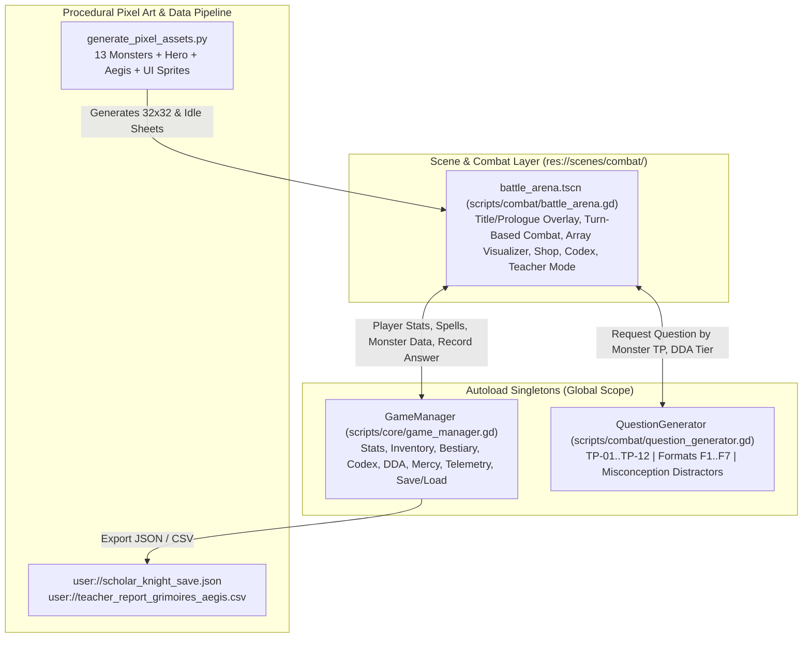
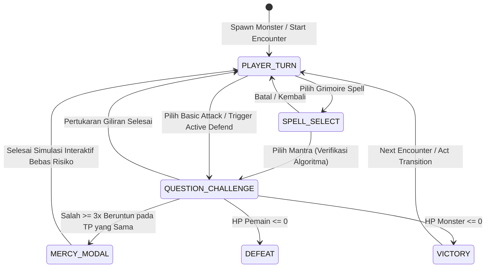
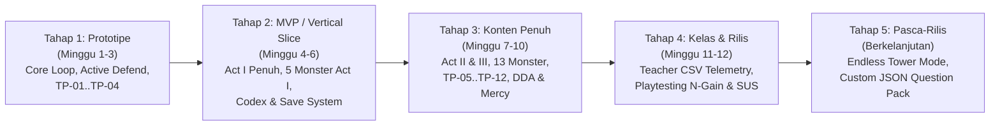

# Grimoire's Aegis: The Scholar Knight — Master Implementation Plan (Godot 4.7)

> **Subtitle:** *The Order of Lost Indexes*  
> **Genre:** 2D Turn-Based RPG / Educational Puzzle Adventure / Fantasy Dungeon Crawler  
> **Engine:** Godot Engine 4.7+ (2D Forward+ / Compatibility Renderer, GDScript 2.0 Static Typing)  
> **Repository:** [`https://github.com/akbarimron/Grimoire-s-Aegis-The-Scholar-Knight.git`](https://github.com/akbarimron/Grimoire-s-Aegis-The-Scholar-Knight.git)  
> **Tim Pengembang (Kelompok 3):**
> - **Ariel Hidayatul Faqih** (`2401265`)
> - **Muhammad Akbar Imron** (`2400000`)
> - **Muhammad Raditya Santosa** (`2409461`)
> - **Khairatul Husna Tartila** (`2400494`)
> - **Septin Sehawati** (`2400923`)

---

## Daftar Isi

1. [Ringkasan Eksekutif & Visi Teknis](#1-ringkasan-eksekutif--visi-teknis)
2. [Arsitektur Sistem & Struktur Proyek Godot 4.7](#2-arsitektur-sistem--struktur-proyek-godot-47)
3. [Hierarki Scene Tree & Autoload Singletons](#3-hierarki-scene-tree--autoload-singletons)
4. [Spesifikasi Implementasi Core Mechanics](#4-spesifikasi-implementasi-core-mechanics)
   - [4.1 Finite State Machine (FSM) Pertarungan Turn-Based](#41-finite-state-machine-fsm-pertarungan-turn-based)
   - [4.2 Mekanika Active Defend (Aegis Shield & Formula Mitigasi)](#42-mekanika-active-defend-aegis-shield--formula-mitigasi)
   - [4.3 Sistem Spellcasting Grimoire (8 Mantra & Limit Break)](#43-sistem-spellcasting-grimoire-8-mantra--limit-break)
5. [Mesin Pedagogi: Procedural Question Generator & Distractor Engine](#5-mesin-pedagogi-procedural-question-generator--distractor-engine)
   - [5.1 Pemetaan 12 Tujuan Pembelajaran (TP-01 s.d. TP-12)](#51-pemetaan-12-tujuan-pembelajaran-tp-01-sd-tp-12)
   - [5.2 Implementasi 7 Format Pertanyaan (F1 s.d. F7)](#52-implementasi-7-format-pertanyaan-f1-sd-f7)
   - [5.3 Algoritma Distractor Berbasis Miskonsepsi & Penjelasan Adaptif](#53-algoritma-distractor-berbasis-miskonsepsi--penjelasan-adaptif)
6. [Sistem Adaptif: Dynamic Difficulty Adjustment (DDA) & Mercy System](#6-sistem-adaptif-dynamic-difficulty-adjustment-dda--mercy-system)
7. [Implementasi 3 Act, 13 Bestiary Monsters & Mekanik Boss](#7-implementasi-3-act-13-bestiary-monsters--mekanik-boss)
8. [Sistem Progresi RPG, Ekonomi Gold, Equipment & Save/Load](#8-sistem-progresi-rpg-ekonomi-gold-equipment--saveload)
9. [Pipeline Aset Visual 16-Bit Pixel Art, UI/UX & Audio 8-Bit/16-Bit](#9-pipeline-aset-visual-16-bit-pixel-art-uiux--audio-8-bit16-bit)
10. [Telemetri Pembelajaran & Mode Guru (CSV/PDF Analytics)](#10-telemetri-pembelajaran--mode-guru-csvpdf-analytics)
11. [Rencana Pengujian, Validasi N-Gain & Quality Assurance](#11-rencana-pengujian-validasi-n-gain--quality-assurance)
12. [Roadmap Eksekusi 5 Tahap & Pembagian Tugas Tim](#12-roadmap-eksekusi-5-tahap--pembagian-tugas-tim)

---

## 1. Ringkasan Eksekutif & Visi Teknis

**Grimoire's Aegis: The Scholar Knight** mengintegrasikan kurikulum **Algoritma Pencarian (*Searching*)** dan **Pengurutan (*Sorting*)** ke dalam mekanika inti pertarungan RPG berbasis giliran (*intrinsic integration*). Berbeda dari kuis tempelan (*extrinsic quiz*), setiap serangan monster dimanifestasikan sebagai deretan angka terkorupsi (*Unordered/Corrupted Array*) yang harus dipecahkan pemain menggunakan perisai suci **Aegis Shield** dan buku mantra **Grimoire** sebelum waktu habis.

### Target Teknis Utama
- **Resolusi Kanvas Native:** `1280x720` (16:9 HD) dengan `canvas_items` stretch mode dan filter tekstur `Nearest` (`default_texture_filter = 0`) untuk ketajaman seni piksel 16-bit murni.
- **Performa:** $\ge 60\text{ FPS}$ stabil di PC spesifikasi rendah (RAM 4 GB, GPU terintegrasi) dan browser HTML5 (WebAssembly).
- **Ukuran Build:** $< 150\text{ MB}$ (Desktop Windows/Linux) dan $< 50\text{ MB}$ (Web HTML5).
- **Validasi Efektivitas Pedagogis:** Peningkatan **N-Gain $\ge 0.3$** (kategori sedang–tinggi) antara *Pre-Test* (Prolog) dan *Post-Test* (Final Boss), serta skor **System Usability Scale (SUS) $\ge 70$**.

---

## 2. Arsitektur Sistem & Struktur Proyek Godot 4.7

Arsitektur perangkat lunak menerapkan pola **Autoload State & Telemetry Manager + Modular Scene Composition + Procedural Pedagogical Engine**.



### Struktur Direktori (`res://`)

```text
The-Scholar-Knight_EDU-GAME/
├── project.godot                     # Konfigurasi Godot 4.7, Autoload GameManager & QuestionGenerator
├── GDD.md                            # Game Design Document Lengkap (18 Bagian - Kelompok 3)
├── IMPLEMENTATION_PLAN.md            # Dokumen Master Implementation Plan ini
├── README.md                         # Dokumentasi Repositori & Panduan Menjalankan
├── generate_pixel_assets.py          # Generator Prosedural Pixel Art 16-Bit (Hero + 13 Monster + UI)
├── assets/
│   └── sprites/
│       ├── characters/               # scholar_knight.png, scholar_knight_idle.png
│       ├── monsters/                 # 13 Monster Bestiary (.png + _idle.png 4-frame sheets)
│       └── ui/                       # aegis_shield.png, parchment_box.png
├── scenes/
│   └── combat/
│       └── battle_arena.tscn         # Scene Utama: Title/Prologue, Turn-Based Combat, Active Defend & Overlays
└── scripts/
    ├── core/
    │   └── game_manager.gd           # Autoload: RPG Stats, 8 Spells, 13 Monsters, DDA, Mercy, CSV
    └── combat/
        ├── battle_arena.gd           # FSM Pertarungan, Visualisasi Array, Boss Mechanics, Overlays
        └── question_generator.gd     # Autoload Mesin Soal Prosedural TP-01..TP-12 & Format F1..F7
```

---

## 3. Hierarki Scene Tree & Autoload Singletons

### 3.1 Autoload Singleton: `GameManager` (`res://scripts/core/game_manager.gd`)
Terdaftar di `project.godot` sebagai `GameManager="*res://scripts/core/game_manager.gd"`. Mengelola:
- **6 Atribut Utama Karakter (`player_stats`):**
  - `HP` (*Health Points*): $\text{HP}_{\text{awal}} = 100$, $+15/\text{level}$, cap `325` pada Lv.15.
  - `MP` (*Mana Points*): $\text{MP}_{\text{awal}} = 50$, $+10/\text{level}$, cap `200` pada Lv.15.
  - `ATK` (*Attack Power*): $\text{ATK}_{\text{awal}} = 12$, $+3/\text{level}$, cap `54` pada Lv.15.
  - `DEF` (*Defense Power*): $\text{DEF}_{\text{awal}} = 8$, $+2/\text{level}$, cap `36` pada Lv.15.
  - `SPD` (*Speed / Focus*): $\text{SPD}_{\text{awal}} = 10$, $+1/\text{level}$, cap `24` pada Lv.15 (setiap 5 poin SPD memberikan $+0.5\text{ detik}$ pada *Active Defend Timer*).
  - `LCK` (*Luck / Critical Insight*): $\text{LCK}_{\text{awal}} = 5$, $+1/\text{level}$, cap `19` pada Lv.15 (menentukan peluang *Critical Strike* $1.5\times$ dan bonus *Gold*).
- **Database 8 Mantra (`SPELLS`):** `linear_slash`, `binary_pierce`, `bubble_shield`, `selection_strike`, `insertion_lance`, `merge_tempest`, `quick_judgment`, dan *Limit Break* `order_restored`.
- **Database 13 Monster (`MONSTERS`) &urutan Gauntlet (`MONSTER_ORDER`):** Mencakup seluruh monster biasa, *Mid-Boss*, dan *Act Boss* dari Act I hingga Act III.
- **Database Equipment (`WEAPONS`, `ACCESSORIES`) & Toko (`items`):** 4 tingkat pedang (*Index Blade* Lv.1–4), 7 aksesori edukatif/pertahanan, dan 6 item konsumabel.
- **Sistem DDA (`dda_tier`), Mercy (`consecutive_wrong_by_tp`), dan Telemetri (`telemetry`, `export_teacher_report_csv()`).**

### 3.2 Hierarki Scene `BattleArena.tscn` (`res://scenes/combat/BattleArena.tscn`)

```text
BattleArena (Control) [scripts/combat/battle_arena.gd]
├── BackgroundLayer (ColorRect)              # Atmosfer palet warna adaptif per Act (Act I/II/III)
├── TorchGlowLeft / TorchGlowRight           # Efek pencahayaan ambient perpustakaan kuno
├── TopHUD (PanelContainer)                  # Bar status atas: Nama Act/Boss, Level, Gold, Tombol Overlay
│   └── TopBar (HBoxContainer)
│       ├── ActLabel /StatusBadge
│       ├── ShopBtn / CodexBtn / ReportBtn / MenuBtn
├── StageArea (Control)                      # Panggung pertarungan visual 16-bit
│   ├── HeroPanel                            # Sprite Scholar Knight (4-frame idle), HP/MP/Focus Bars, Status Badges
│   ├── CenterVisualizer                     # Visualisasi Array Interaktif (Bar proporsional + Indeks + Pointer L/M/R)
│   └── MonsterPanel                         # Sprite Monster/Boss (4-frame idle), HP Bar, Intent & Lore Label
├── CombatLogPanel (PanelContainer)          # Log narasi pertarungan & penjelasan langkah algoritma (RichTextLabel)
├── BottomDeck (HBoxContainer)               # Panel Komando Turn-Based & Active Defend
│   ├── ActionMenuPanel                      # [Attack, Grimoire Spells, Items, Inspect Codex]
│   └── ActiveDefendPanel                    # Pertanyaan F1-F7, Timer Bar, Hint Button, 4 Pilihan Jawaban [1-4]
└── DynamicOverlays (CanvasLayer / Panel)    # Modal Codex Grimoire, Merchant Shop, Teacher Analytics, Mercy Modal
```

---

## 4. Spesifikasi Implementasi Core Mechanics

### 4.1 Finite State Machine (FSM) Pertarungan Turn-Based

Pertarungan dikendalikan oleh enum `BattleState` di [`battle_arena.gd`](file:///D:/Project/The-Scholar-Knight_EDU-GAME/scripts/combat/battle_arena.gd):



### 4.2 Mekanika Active Defend (Aegis Shield & Formula Mitigasi)

Saat monster menyerang atau pemain merapal mantra melalui **Aegis Shield**, sistem membangkitkan tantangan algoritmik berdasarkan matriks kurikulum monster tersebut.

#### Formula Timer Active Defend
$$\text{Waktu Total} = \left(T_{\text{dasar}} + \left\lfloor\frac{\text{SPD}}{5}\right\rfloor \times 0.5 + B_{\text{aksesori}} + B_{\text{DDA}}\right) \times M_{\text{mode}} \times M_{\text{status}}$$
- $T_{\text{dasar}} \in \{10, 12, 15, 20, 25\}\text{ detik}$ sesuai jenis tantangan (`TP-01` s.d. `TP-12`).
- $B_{\text{aksesori}}$: $+3.0\text{ detik}$ jika mengenakan *Hourglass of Patience*.
- $B_{\text{DDA}}$: $+3.0\text{ detik}$ pada tier *Assisted*, $-2.0\text{ detik}$ pada tier *Mastery*.
- $M_{\text{mode}}$: $1.0\times$ (*Normal*), $1.5\times$ (*Story / Relaxed*), $\infty$ (*Infinite Timer Accessibility*).
- $M_{\text{status}}$: $0.7\times$ jika terkena status *Crushed* dari *The Abyss Golem*.

#### Tabel Resolusi Active Defend

| Kondisi Jawaban Pemain | Status Pertahanan | Mitigasi Damage | Efek Balasan & Bonus |
| :--- | :--- | :---: | :--- |
| **Benar & Cepat** ($\text{Sisa Waktu} \ge 50\%$) | **PERFECT PARRY!** | **100% (0 Damage)** | *Counter-Attack* $1.5\times \text{ATK}$, $+25\text{ Focus}$, $+15\%\text{ EXP}$ |
| **Benar & Biasa** ($\text{Sisa Waktu} < 50\%$) | **SOLID BLOCK!** | **75% Damage Reduction** | $+10\text{ Focus}$, monster kehilangan momentum |
| **Salah / Waktu Habis** (Dengan *Aegis Charm* aktif) | **AEGIS CHARM AUTO-BLOCK!** | **75% Damage Reduction** | Sekali per pertarungan mencegah kegagalan fatal |
| **Salah / Waktu Habis** (Normal) | **GUARD BROKEN!** | **0% (100% Damage Masuk)** | Terkena *debuff* monster (*Poison/Silence/Torn Page/Buried/Death Seal*) + Penjelasan langkah benar |

### 4.3 Sistem Spellcasting Grimoire (8 Mantra & Limit Break)

Diimplementasikan di `GameManager.SPELLS` dan dieksekusi di `battle_arena.gd`:
1. **`linear_slash` (*Linear Slash*):** `10 MP` | `1.2x ATK` | Elemen Sequential (`TP-01`, `TP-02`).
2. **`binary_pierce` (*Binary Pierce*):** `18 MP` | `2.0x ATK` | Mengabaikan 50% DEF pada array terurut (`TP-03`, `TP-04`).
3. **`bubble_shield` (*Bubble Shield*):** `15 MP` | `1.35x ATK` | Memberikan barrier pertahanan + membersihkan debuff *Poison/Torn Page* (`TP-05`, `TP-06`).
4. **`selection_strike` (*Selection Strike*):** `20 MP` | `1.8x ATK` | Menarget nilai ekstrem minimum/maksimum (`TP-07`).
5. **`insertion_lance` (*Insertion Lance*):** `22 MP` | `2.1x ATK` | Bonus *Critical* +25% pada array hampir terurut (`TP-08`).
6. **`merge_tempest` (*Merge Tempest*):** `30 MP` | `2.6x ATK` | Serangan multi-hit *Divide & Conquer* (`TP-09`).
7. **`quick_judgment` (*Quick Judgment*):** `35 MP` | `3.2x ATK` | Damage masif dengan penentuan pivot *Quick Sort* (`TP-10`).
8. **`order_restored` (*Order Restored — Limit Break*):** `0 MP` (Membutuhkan **100 Focus**) | `3.5x Pure Damage` | Menembus 100% DEF musuh dan memulihkan 25% HP pemain.

---

## 5. Mesin Pedagogi: Procedural Question Generator & Distractor Engine

Seluruh soal dibangkitkan secara prosedural oleh [`question_generator.gd`](file:///D:/Project/The-Scholar-Knight_EDU-GAME/scripts/combat/question_generator.gd) menggunakan *Random Seed* unik (`seed_id`) sehingga pemain tidak dapat sekadar menghafal kunci jawaban.

### 5.1 Pemetaan 12 Tujuan Pembelajaran (`TP-01` s.d. `TP-12`)

| Kode TP | Level Taksonomi Bloom | Sub-Topik Algoritma | Implementasi Fungsi di `question_generator.gd` |
| :---: | :---: | :--- | :--- |
| **TP-01** | C2 (Memahami) | Konsep & Langkah *Linear Search* | `_gen_linear_search()` (mode trace indeks & jumlah langkah) |
| **TP-02** | C3 (Menerapkan) | Simulasi *Linear Search* (Target Ada / Tidak Ada) | `_gen_linear_search()` (termasuk kasus $n$ komparasi penuh saat elemen absen) |
| **TP-03** | C2 (Memahami) | Prasyarat Data Terurut & Konsep *Binary Search* | `_gen_binary_prereq()` (validasi syarat mutlak *sorted array*) |
| **TP-04** | C3 (Menerapkan) | Eksekusi *Midpoint* $\lfloor(L+R)/2\rfloor$ & Eliminasi Ruang | `_gen_binary_search()` (kalkulasi `mid`, nilai `A[mid]`, dan pembaruan batas `L`/`R`) |
| **TP-05** | C4 (Menganalisis) | Komparasi Efisiensi *Linear* vs *Binary Search* | `_gen_search_comparison()` (analisis $O(n)$ vs $O(\log_2 n)$ pada ukuran data besar) |
| **TP-06** | C3 (Menerapkan) | Mekanisme Pertukaran (*Swap*) *Bubble Sort* | `_gen_bubble_sort()` (hasil *Pass* ke-1 dan penempatan nilai maksimum di ujung kanan) |
| **TP-07** | C3 (Menerapkan) | Pencarian Nilai Minimum & *Swap* *Selection Sort* | `_gen_selection_sort()` (identifikasi elemen terkecil dan pertukaran dengan indeks awal *pass*) |
| **TP-08** | C3 (Menerapkan) | Penyisipan Elemen Kunci (*Key*) *Insertion Sort* | `_gen_insertion_sort()` (pergeseran sub-array kiri terurut untuk menyisipkan `key`) |
| **TP-09** | C4 (Menganalisis) | Pemecahan & Penggabungan *Merge Sort* | `_gen_merge_sort()` (urutan perbandingan dua sub-array terurut saat fase *Merge*) |
| **TP-10** | C4 (Menganalisis) | Partisi *Pivot* *Quick Sort* | `_gen_quick_sort()` (pemisahan sub-array kiri $< \text{pivot}$ dan kanan $> \text{pivot}$) |
| **TP-11** | C5 (Mengevaluasi) | Pemilihan Algoritma Terbaik Berdasarkan Konteks Data | `_gen_algorithm_evaluation()` (studi kasus *nearly sorted*, *unindexed stream*, dataset jutaan) |
| **TP-12** | C4 (Menganalisis) | Kompleksitas Waktu Big-O (*Best, Average, Worst*) | `_gen_complexity_analysis()` (evaluasi kompleksitas waktu dan ruang) |

### 5.2 Implementasi 7 Format Pertanyaan (`F1` s.d. `F7`)

1. **`F1` (*Next-Step Prediction*):** Memprediksi indeks yang diperiksa berikutnya atau pembaruan batas `[L..R]` pada *Binary Search*.
2. **`F2` (*Element Swap Execution*):** Menentukan pasangan elemen yang harus ditukar atau posisi *swap* pertama pada *Bubble/Selection Sort*.
3. **`F3` (*Pass Result Identification*):** Mengidentifikasi susunan array yang tepat setelah 1 *Pass* penuh selesai.
4. **`F4` (*Algorithm Matching / Case Study*):** Memilih algoritma paling optimal untuk skenario nyata (misal data hampir terurut $\rightarrow$ *Insertion Sort*).
5. **`F5` (*Complexity & Comparison Count*):** Menghitung jumlah maksimal komparasi $\lceil\log_2 N\rceil$ atau menentukan kelas kompleksitas Big-O.
6. **`F6` (*Error Spotting / Corrupt Trace*):** Mendeteksi langkah yang salah pada jejak eksekusi algoritma yang telah dirusak monster.
7. **`F7` (*Partition / Merge Builder*):** Menyusun hasil partisi *Quick Sort* di sekitar *pivot* atau penggabungan dua sub-array terurut pada *Merge Sort*.

### 5.3 Algoritma Distractor Berbasis Miskonsepsi & Penjelasan Adaptif

Setiap opsi pengecoh (*distractor*) dipetakan dalam dictionary `misconception_map`:
- **Miskonsepsi Indeks Berbasis 1 vs Berbasis 0:** Pemain menjawab indeks ke-4 padahal indeks berbasis 0 adalah `3`.
- **Miskonsepsi Arah Eliminasi Binary Search:** Saat $A[\text{mid}] < \text{Target}$, pemain menggeser `R = mid - 1` alih-alih `L = mid + 1`.
- **Miskonsepsi Prasyarat Binary Search:** Mencoba menjalankan *Binary Search* pada array acak tanpa mengurutkannya terlebih dahulu.
- **Miskonsepsi Selection vs Bubble Swap:** Menukar elemen bersebelahan pada *Selection Sort* alih-alih menunggu hingga elemen minimum ditemukan di akhir iterasi.

Ketika pemain memilih pengecoh tersebut, panel **Combat Log & Pedagogical Feedback** menampilkan diagnosis spesifik mengapa opsi tersebut keliru beserta langkah algoritma yang benar.

---

## 6. Sistem Adaptif: Dynamic Difficulty Adjustment (DDA) & Mercy System

### 6.1 Parameter Dynamic Difficulty Adjustment (DDA)

Diimplementasikan di [`game_manager.gd`](file:///D:/Project/The-Scholar-Knight_EDU-GAME/scripts/core/game_manager.gd) (`_update_dda()`):

| Tier DDA | Kondisi Pemicu (5 Soal Terakhir) | Ukuran Array ($N$) | Bonus Timer | Rentang Angka |
| :---: | :--- | :---: | :---: | :---: |
| **Tier 1: Assisted** | Akurasi $< 50\%$ atau 2x salah berturut-turut | $5 - 6$ elemen | $+3.0\text{ detik}$ | $1 - 30$ (tanpa duplikat) |
| **Tier 2: Standard** | Akurasi $50\% - 80\%$ | $6 - 8$ elemen | $+0.0\text{ detik}$ | $10 - 99$ |
| **Tier 3: Mastery** | Akurasi $> 85\%$ dengan waktu jawab $< 50\%$ | $8 - 10$ elemen | $-2.0\text{ detik}$ | $10 - 150$ (*edge cases*) |

### 6.2 Mekanika Mercy System (*Grimoire Guidance*)

Jika pemain gagal menjawab **3 kali berturut-turut** pada Tujuan Pembelajaran (`TP`) yang sama (`consecutive_wrong_by_tp[tp] >= 3`):
1. `GameManager.consume_mercy_trigger(tp)` mengembalikan `true`.
2. `BattleArena` membekukan serangan monster dan membuka **Mercy Guidance Modal** (*Grimoire Guidance*).
3. Pemain diberikan panduan interaktif langkah demi langkah dari **Codex Grimoire** untuk `TP` tersebut tanpa penalti HP, serta pemulihan fokus/perisai sebelum kembali bertarung.

---

## 7. Implementasi 3 Act, 13 Bestiary Monsters & Mekanik Boss

Seluruh **13 Monster** dari Bagian 7.2 GDD telah diimplementasikan lengkap beserta aset sprite piksel 16-bit (`32x32` statis dan `128x32` 4-frame idle sheet) serta efek status khusus:

| # | ID Monster | Nama Monster | Act & Peran | HP / ATK / DEF | Topik Kurikulum | Mekanik & Efek Status Khusus |
| :-: | :--- | :--- | :---: | :---: | :---: | :--- |
| 1 | `corrupted_slime` | **Corrupted Slime** | Act I — Biasa | `45 / 10 / 3` | `TP-01, TP-02` | *Sticky Index* (memperlambat animasi pointer) |
| 2 | `lost_wisp` | **Lost Wisp** | Act I — Biasa | `60 / 13 / 4` | `TP-02, TP-03` | *Flicker Array* (menyembunyikan 1 angka sementara) |
| 3 | `bookworm_horror` | **Bookworm Horror** | Act I — Biasa | `72 / 14 / 5` | `TP-01, TP-03` | **Torn Page** (mengaburkan 1 opsi jawaban jika gagal) |
| 4 | `twin_faced_librarian` | **Twin-Faced Librarian** | Act I — Mid-Boss | `150 / 18 / 8` | `TP-03, TP-05` | **Silence** (mengunci 1 mantra Grimoire selama 2 giliran) |
| 5 | `the_blind_archivist` | **The Blind Archivist** | **Act I — BOSS** | `260 / 22 / 10` | `TP-01..TP-05` | **Shroud of Fog** (Fase 1: acak $\rightarrow$ Fase 2: urut + kabut nilai array) |
| 6 | `skeleton_archer` | **Skeleton Archer** | Act II — Biasa | `95 / 20 / 8` | `TP-06, TP-07` | *Rapid Volley* (menuntut eksekusi *swap* cepat) |
| 7 | `venomous_arachnid` | **Venomous Arachnid** | Act II — Biasa | `110 / 22 / 9` | `TP-06, TP-08` | **Poison** ($-5\%\text{ Max HP}$ per giliran selama 3 giliran) |
| 8 | `grave_digger` | **Grave Digger** | Act II — Biasa | `135 / 24 / 12` | `TP-07, TP-08` | **Buried Index** (menyembunyikan nilai elemen di bawah tanah) |
| 9 | `the_abyss_golem` | **The Abyss Golem** | **Act II — BOSS** | `420 / 30 / 18` | `TP-06..TP-08` | **Heavy Stone Armor** (imun serangan fisik biasa; wajib *Sorting Combo*) + **Crushed** ($-30\%$ timer) |
| 10 | `hydra_of_division` | **Hydra of Division** | Act III — Biasa | `190 / 28 / 14` | `TP-09, TP-12` | **Divide & Regrow** (regenerasi $+15\%\text{ HP}$ jika gagal menjawab fase *Merge*) |
| 11 | `pivot_wraith` | **Pivot Wraith** | Act III — Biasa | `210 / 32 / 15` | `TP-10, TP-12` | **False Pivot** (damage ganda jika salah menentukan posisi *pivot*) |
| 12 | `the_sphinx_of_entropy` | **The Sphinx of Entropy** | Act III — Mid-Boss | `340 / 35 / 16` | `TP-11, TP-12` | **3 Death Seals** (3 segel teka-teki evaluasi algoritma; gagal 3x memicu serangan fatal) |
| 13 | `entropy_chaos_king` | **Entropy, The Chaos King** | **Act III — FINAL BOSS** | `680 / 42 / 22` | `TP-01..TP-12` | **3 Fase Transformasi** + **Unshuffle the Grand Catalog** (10 buku kuno di fase klimaks) |

---

## 8. Sistem Progresi RPG, Ekonomi Gold, Equipment & Save/Load

### 8.1 Tabel Kurva Level & EXP (`Level 1` s.d. `Level 15`)
Diimplementasikan secara eksponensial terkalibrasi di `GameManager.EXP_TABLE`:
- **Act I:** Level 1 $\rightarrow$ Level 5 (`0` s.d. `1150 EXP`)
- **Act II:** Level 5 $\rightarrow$ Level 10 (`1150` s.d. `5200 EXP`)
- **Act III:** Level 10 $\rightarrow$ Level 15 (`5200` s.d. `15000 EXP`)

### 8.2 Daftar Senjata (*Weapons*) & Aksesori (*Accessories*)
- **Senjata:**
  1. *Index Blade Lv.1 (Rusty Pointer)* — Base ATK +0
  2. *Index Blade Lv.2 (Sorted Edge)* — +8 ATK (`150 Gold`)
  3. *Index Blade Lv.3 (Binary Saber)* — +18 ATK (`350 Gold`)
  4. *Index Blade Lv.4 (Grand Archivist Greatsword)* — +32 ATK (`700 Gold`)
- **Aksesori:**
  1. *Scholar's Monocle* (`120 Gold`): Menghapus 1 opsi jawaban salah secara otomatis saat menggunakan *Hint*.
  2. *Hourglass of Patience* (`180 Gold`): Menambah $+3\text{ detik}$ pada *Active Defend Timer*.
  3. *Ring of Complexity* (`200 Gold`): Mengurangi biaya MP seluruh mantra Grimoire sebesar $20\%$.
  4. *Aegis Charm* (`250 Gold`): Sekali per pertarungan mengubah kegagalan *Active Defend* menjadi *Solid Block* (75% mitigasi).
  5. *Boots of Swiftness* (`140 Gold`): $+5\text{ SPD}$ ($+0.5\text{ detik}$ timer permanen).
  6. *Cloak of the Archivist* (`220 Gold`): $+10\text{ DEF}$ dan imun terhadap efek *Torn Page*.
  7. *Pendant of Clarity* (`190 Gold`): Imun terhadap efek *Silence* dan *Poison*.

### 8.3 Persistensi Save/Load JSON
Data permainan disimpan secara otomatis maupun manual ke `user://grimoires_aegis_save.json` mencakup level, atribut, inventori, progres monster yang telah dikalahkan, riwayat akurasi per-TP, serta preferensi aksesibilitas.

---

## 9. Pipeline Aset Visual 16-Bit Pixel Art, UI/UX & Audio 8-Bit/16-Bit

### 9.1 Generator Prosedural Pixel Art (`generate_pixel_assets.py`)
Skrip [`generate_pixel_assets.py`](file:///D:/Project/The-Scholar-Knight_EDU-GAME/generate_pixel_assets.py) menghasilkan seluruh aset karakter, perisai, UI box, dan 13 monster dengan estetika *Dark Fantasy Library* 16-bit:
- Setiap entitas memiliki **sprite statis `32x32`** dan **spritesheet animasi idle 4-frame `128x32`** (siklus bernapas / mengambang / berkedip).
- Visualisasi Array di tengah panggung pertarungan menyesuaikan tema warna setiap Act:
  - **Act I (*Dusty Archives*):** Perkamen emas & batu tulis (`#d4af37`, `#3a4e6b`).
  - **Act II (*Catacombs of Chaos*):** Pilar batu zamrud & obor biru (`#2ec4b6`, `#4a5568`).
  - **Act III (*Tower of Entropy*):** Kristal ungu kosmik & merah kirmizi (`#9b5de5`, `#e63946`).

### 9.2 Aksesibilitas & Kontrol Penuh (Mouse + Keyboard)
- **Pintasan Keyboard Pertarungan:**
  - `1` / `2` / `3` / `4`: Memilih aksi di menu giliran atau memilih opsi jawaban `A` / `B` / `C` / `D` saat *Active Defend*.
  - `H` / `5`: Mengaktifkan *Grimoire Hint* (menyorot batas `L`, `Mid`, `R` atau pasangan elemen *swap*).
  - `Tab`: Membuka/menutup **Codex Grimoire** (*In-Game Encyclopedia* `TP-01` s.d. `TP-12`).
  - `T`: Membuka/menutup **Teacher Analytics Report** + tombol **Export CSV**.
- **Fitur Aksesibilitas (Bagian 10.6 GDD):**
  - *Timer Multiplier*: Normal ($1.0\times$), Story/Relaxed ($1.5\times$), atau *Infinite Timer*.
  - *Colorblind / High-Contrast Mode*: Menampilkan simbol indikator bentuk (`[L]`, `[M]`, `[R]`, `[*]`) selain warna pada bar array.
  - *Screen Shake Toggle*: Dapat dimatikan bagi pemain sensitif gerak.

---

## 10. Telemetri Pembelajaran & Mode Guru (CSV/PDF Analytics)

Untuk mendukung evaluasi akademik oleh guru/dosen, `GameManager` mencatat metrik real-time per Tujuan Pembelajaran (`TP-01` s.d. `TP-12`) dan mengekspornya melalui `GameManager.export_teacher_report_csv()` ke `user://teacher_report_telemetry.csv`:

### Skema Kolom CSV Telemetri Guru
```csv
TP_Code,Topic_Name,Attempts,Correct,Accuracy_Percent,Avg_Response_Time_Sec,Mastery_Status,Top_Misconception
TP-01,"Linear Search Concept",6,5,83.3,4.21,"MASTERED","None"
TP-04,"Binary Search Execution",8,6,75.0,6.85,"PROFICIENT","Reversed L/R elimination direction"
...
```
Selain ekspor file CSV, layar **Teacher Mode Overlay** di dalam game menampilkan:
- Ringkasan *Pre-Test Score*, *Post-Test Score*, dan kalkulasi **Normalized Gain (N-Gain)** otomatis:
  $$\langle g \rangle = \frac{\text{Skor}_{\text{Post}} - \text{Skor}_{\text{Pre}}}{100 - \text{Skor}_{\text{Pre}}}$$
- Tabel akurasi dan waktu respons rata-rata untuk seluruh 12 TP.
- Diagnosis kelemahan utama siswa beserta rekomendasi remedial.

---

## 11. Rencana Pengujian, Validasi N-Gain & Quality Assurance

### 11.1 Pengujian Teknis (Unit & Integration Testing)
1. **Validasi Headless Godot 4.7:** Menjalankan `Godot_v4.7.2-stable_win64_console.exe --headless --quit` untuk memastikan nol *parse error*, nol *missing resource*, dan integritas seluruh Autoload/Scene.
2. **Validasi Determinisme Soal Prosedural:** Menguji setiap fungsi generator (`TP-01` s.d. `TP-12` pada format `F1` s.d. `F7`) untuk memastikan:
   - Selalu terdapat tepat 4 pilihan jawaban unik.
   - `correct_index` selalu menunjuk pada jawaban yang secara matematis/algoritmik benar.
   - Pada soal *Binary Search* (`TP-04`), array dijamin terurut menaik.
3. **Uji Keseimbangan Ekonomi & Combat (*Combat Simulation*):** Memastikan pemain dengan akurasi $70\%$ dapat menyelesaikan Act I–III tanpa *grinding* berlebihan, sementara pemain dengan akurasi $< 40\%$ dibantu oleh *DDA Tier 1* dan *Mercy System*.

### 11.2 Protokol Evaluasi Kelas (Pre-Test, Post-Test & SUS)
1. **Pre-Test (Prolog Dungeon):** 5 soal diagnostik awal sebelum pemain mendapatkan kekuatan penuh Grimoire.
2. **Intervensi Gameplay (Act I – Act III):** Sesi bermain $3 \times 35\text{ menit}$ (atau mandiri).
3. **Post-Test (Pertarungan Final *Entropy, The Chaos King*):** Evaluasi komprehensif lintas `TP-01` s.d. `TP-12`.
4. **Target Keberhasilan:** Rata-rata $\langle g \rangle \ge 0.30$ dan skor kuesioner **SUS $\ge 70$**.

---

## 12. Roadmap Eksekusi 5 Tahap & Pembagian Tugas Tim

Sesuai **Bagian 18 GDD (Rencana Pengembangan & Roadmap)**:



### Matriks Tanggung Jawab Tim (Kelompok 3)

| Nama Anggota | NIM | Peran Utama & Modul Tanggung Jawab |
| :--- | :---: | :--- |
| **Ariel Hidayatul Faqih** | `2401265` | **Game Designer & Systems Balancing:** Desain mekanika *Active Defend*, kurva progresi RPG, rumus damage/timer, dan keseimbangan 13 monster. |
| **Muhammad Akbar Imron** | `2400000` | **Lead Programmer & Engine Architect:** Arsitektur Godot 4.7 (`GameManager`, `BattleArena` FSM), integrasi *Procedural Question Generator*, DDA, dan *Git Release*. |
| **Muhammad Raditya Santosa** | `2409461` | **Gameplay & UI/UX Programmer:** Visualisasi Array interaktif, HUD 16-bit, *Codex Grimoire*, *Merchant Shop*, pintasan keyboard, dan fitur aksesibilitas. |
| **Khairatul Husna Tartila** | `2400494` | **Instructional Designer & Curriculum Specialist:** Penyusunan matriks `TP-01`–`TP-12`, format soal `F1`–`F7`, pemetaan pengecoh miskonsepsi, dan narasi *Codex*. |
| **Septin Sehawati** | `2400923` | **QA Lead, Art Direction & Educational Analytics:** Pipeline aset piksel 16-bit, telemetri *Teacher Mode* CSV, instrumen *Pre/Post-Test* N-Gain, dan pengujian SUS. |
